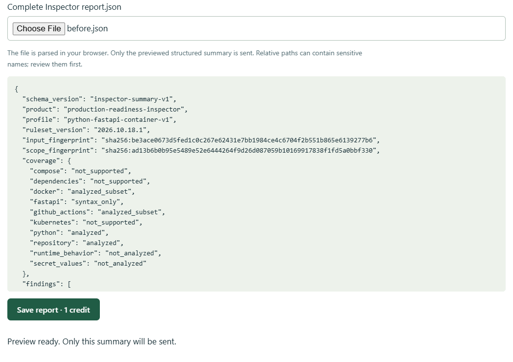
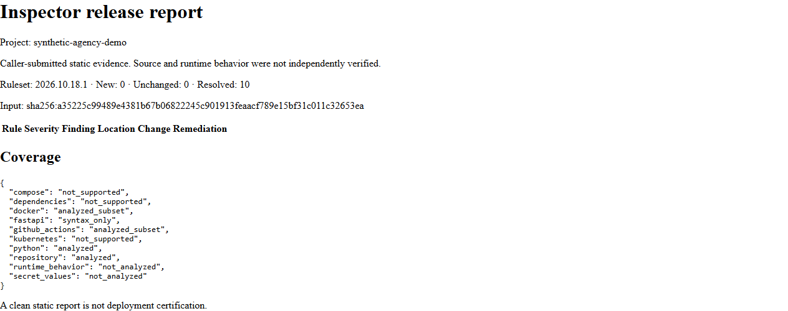
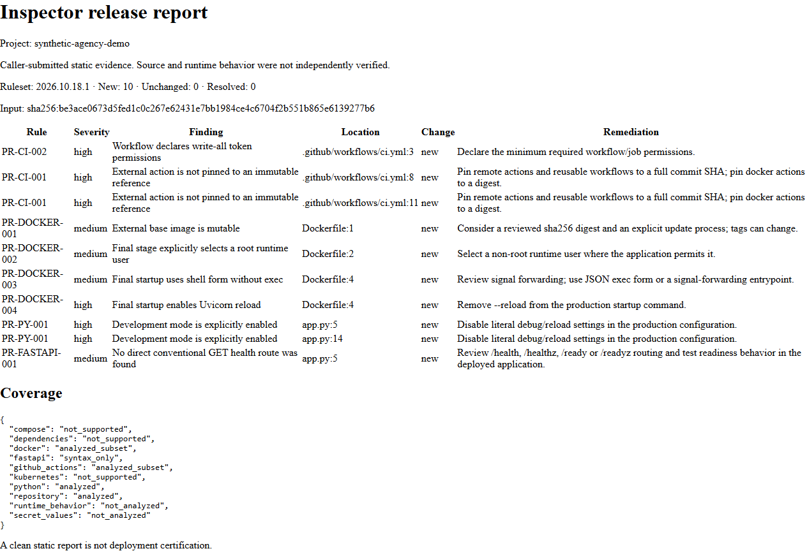

# Inspector for Python agency release handoffs

Give clients a clear record of what changed before their next Python release.
Run Inspector locally, review the outgoing metadata, and keep a private comparison
between releases. **[Try three hosted reports free](https://inspector.contentsweep.ai/inspector#workspace),
then $19 USD for 100 reports.** Local scans remain free. There is no subscription
or automatic top-up.

This walkthrough uses **synthetic fixtures**, not a customer project. The
published v0.3.0 scanner finds ten instances in the first fixture. The corrected
fixture has zero findings in the shipped rules and resolves those ten instances.
The examples are parsing fixtures: do not build their Docker images or run their
GitHub workflows. Their placeholder digests are not downloadable artifacts.

## Install the published release

Use Python 3.12 on Linux or Ubuntu WSL2. A dedicated environment avoids overlap
with any existing MCPProducts installation. From a directory where you keep
development checkouts:

```bash
git clone https://github.com/founder-sweep/production-readiness-inspector.git
cd production-readiness-inspector
python3.12 -m venv .inspector-venv
.inspector-venv/bin/python -m pip install --no-deps \
  https://inspector.contentsweep.ai/inspector/download/contentsweep_prodcheck-0.3.0-py3-none-any.whl
```

The wheel SHA-256 is
`9761f945a9b6d618ea7f16a381036992803522c038501b303a2cbe334da36b71`.
Compare downloads with the [release manifest](https://inspector.contentsweep.ai/inspector/download/manifest.json).
There is no PyPI installation step. The core scanner has no third-party
dependencies and makes no network or model calls while scanning.

## Make the first local report

```bash
mkdir -p .demo-reports
.inspector-venv/bin/prodcheck examples/inspector/defective \
  --format json --fail-on none > .demo-reports/before.json
.inspector-venv/bin/prodcheck examples/inspector/corrected \
  --baseline .demo-reports/before.json --format json \
  > .demo-reports/after.json
```

`--fail-on none` keeps the first demonstration command successful when it finds
issues. Evaluation failures still exit 5. For a real CI gate, omit this option:
the default high-finding threshold exits 2. A complete result is required before
accepting a baseline or saving a hosted report.

| Synthetic release | Current findings | New | Unchanged | Resolved |
|---|---:|---:|---:|---:|
| Before | 10 | 10 | 0 | 0 |
| After | 0 | 0 | 0 | 10 |

The local baseline is in `after.json` under `metadata.baseline`. Hosted history
independently compares complete summaries saved under the same project name.

## Preview and save the hosted handoff

1. Open [Inspector](https://inspector.contentsweep.ai/inspector#workspace) and
   create a free workspace. Save its key privately before buying or closing the
   browser. The key is the only credential; there is no email/password recovery.
2. Set a project name such as `demo-client-api`. Select `before.json`. Inspect
   the preview before clicking **Save report · 1 credit**.
3. Select `after.json` under the **same project name**, review it, and save it.
   The second comparison shows ten resolved instances.
4. Download HTML from the saved reports list. JSON is available through the
   cloud CLI/API. Use the third free report on a later complete scan if useful.



*Report preview: the selected synthetic local report is reduced to structured
metadata in the browser before submission. No workspace key is shown.*



*Baseline comparison: an actual HTML export from the live report API, using an
internally classified demonstration workspace.*



*Initial handoff: the same export format customers receive. Synthetic findings
and relative locations illustrate what a reviewer can inspect.*

The [initial HTML handoff](assets/before-handoff.html),
[corrected HTML handoff](assets/after-handoff.html),
[metadata summaries](assets/before-summary.json), and
[verification record](assets/demonstration.json) are public synthetic examples.
For HTML, download the file and open it in a browser; GitHub shows its source.

## Use your own client project

Scan a stable, authorized checkout with the same environment:

```bash
.inspector-venv/bin/prodcheck /path/to/client-application --format json > release.json
.inspector-venv/bin/python -m mcp_products.inspector.cloud preview release.json
```

Review findings, coverage, and incomplete-evaluation issues. Keep client names
out of project labels and paths when that matters to your client. Only supported
rule/version/instance identities, relative paths and lines, coverage, and
fingerprints are accepted by the hosted service. Raw source, excerpts, arbitrary
evidence text, and repository archives are excluded. Paths and fingerprints may
still be sensitive; inspect the preview.

Each new complete hosted report uses one credit. Exact retries reuse their
receipt. Incomplete or invalid inputs and service failures do not consume
credits. Hosted payloads remain for 30 days, with maintenance removing expired
payloads within another hour; operational backups may retain them for up to
seven additional days. Credits do not expire. See [terms, privacy, and refunds](https://inspector.contentsweep.ai/inspector#terms).

The supported static profile covers literal FastAPI/Uvicorn settings, directly
declared conventional GET health routes, Docker startup configuration, and
supported GitHub Actions declarations. Dynamic configuration, cross-file router
resolution, Compose/Kubernetes, CVEs, and runtime readiness are outside this
beta. A hosted handoff preserves caller-submitted evidence; it does not certify
deployment health or independently verify the source.

Use the [client-release checklist](FASTAPI_HANDOFF_CHECKLIST.md) before delivery
and [the comparison guide](COMPARE_RELEASES.md) when preparing the next release.
Questions about a trial or billing: **founder@contentsweep.ai**. Never email a
workspace key or private client source.
